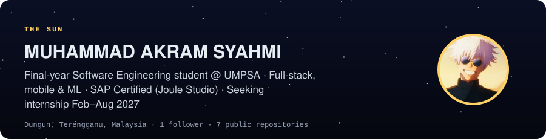
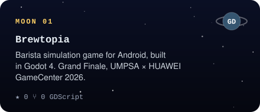
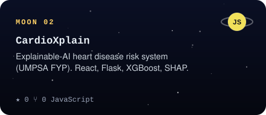
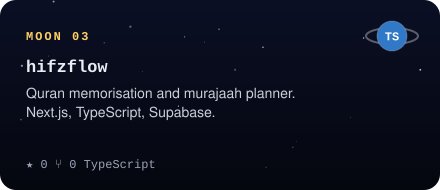
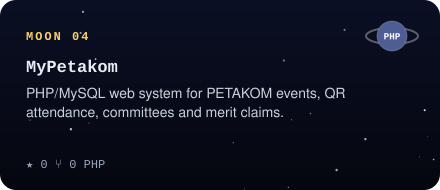
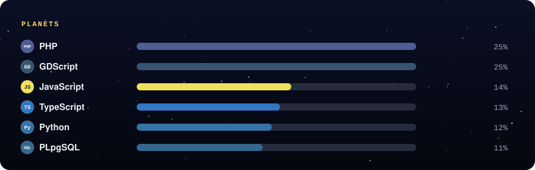
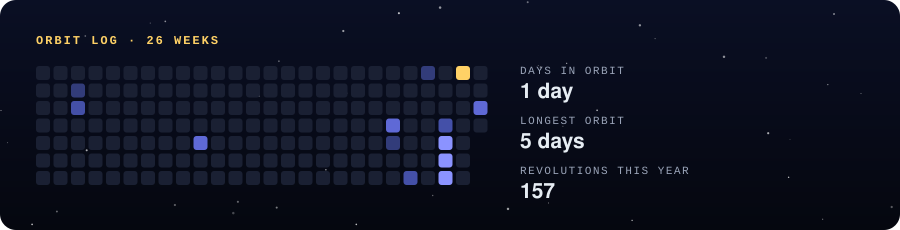

  

I am the sun; my languages are the planets and my projects their moons.

  

  
  
  
  

  
  

### About

I build web and mobile apps end to end, from requirements and design to tests. I care most about
software that keeps working when things go wrong: failure states for slow APIs, database
constraints behind app checks, and test suites that catch real bugs.

Outside code I'm a hafiz (all 30 juz'), which is where [HifzFlow](https://hifzflow-phi.vercel.app) came from. I've also helped lead
faculty and university sports events.

**Highlights**
- **CardioXplain:** XGBoost model (0.80 AUC on 13,720 unseen records), SHAP explanations turned into plain language by an LLM, 250+ automated tests.
- **HifzFlow:** 143 unit tests and 230 SQL assertions, including a row-level-security suite that found three bugs. [Live](https://hifzflow-phi.vercel.app).
- **Brewtopia:** Grand Finale, UMPSA × HUAWEI GameCenter 2026.
- **Team projects not on this account:** SAMS (Flutter + Laravel attendance module) and ScamShield MY (scam checker, finalist at Hackathon X 2026).

**Also:** Java, SQL, Flutter, Laravel, Flask, REST APIs, LLM APIs, pytest, Vitest, SAP ERP coursework (FI, SD, MM, WM, PP, EAM, HCM)

**Certifications:** SAP Certified – Joule Studio Developer · Oracle Cloud Infrastructure 2025 Foundations Associate · Huawei ICT Competition 2026–2027, National Stage (Cloud) · Dean's List, 6 semesters, CGPA 3.74

  <a href="https://www.linkedin.com/in/muhammad-akram-syahmi-ab4607294">LinkedIn</a> ·
  <a href="mailto:akramsyahmi110061@gmail.com">Email</a> ·
  <a href="https://github.com/AkramSyahmi">GitHub</a>

Solar System · planets are languages, moons are pinned repos, comets are recent pushes · cards rebuilt daily by <a href="solar/build.mjs">solar/build.mjs</a>

